# Allan Simões Adegas

**Software Engineer · Backend, Applied AI, and Cloud**

I build APIs, event-driven systems, and LLM applications in Python. I also work with React to ship products end to end. I hold a degree in Computer Engineering from UTFPR and am based in Londrina, Brazil.

## Experience

- **The Soil Company** · I manage Google Cloud infrastructure and build an agronomy consulting platform with C#, Python and React. I led a cloud migration that reduced costs by about **30%**.
- **BTG Pactual** · I built asynchronous FastAPI services and event-driven microservices on AWS to monitor financial transactions. I developed an LLM-powered email review tool that validated extracted data against an internal API and saved **more than 220 hours of manual work per month**.

## Projects

- [**KnowledgeDesk**](https://github.com/AllanAdegas/KnowledgeDesk) · A local document assistant with retrieval-augmented generation (RAG), source citations, and a LangGraph agent that searches and summarizes files. Built with Python, FastAPI, Ollama, and React.
- **ReconAgent** *(in development)* · Reconciles trade confirmation emails against a ledger using synthetic data. LangGraph orchestrates LLM extraction and deterministic validation. Discrepancies go to human review, and an offline evaluation suite measures decision accuracy and false approvals.
- **Pier** · A self-hosted deployment platform with HTTPS, readiness checks, and automatic rollbacks. Built with Go and SolidJS, with support for Docker and Kubernetes.

## Tech stack

I build LLM workflows with **LangChain** and **LangGraph**, using structured outputs, validation, and offline evaluations.

## Contact

[LinkedIn](https://www.linkedin.com/in/allan-simoes-adegas) · [Email](mailto:allansimoesadegas11@gmail.com)
